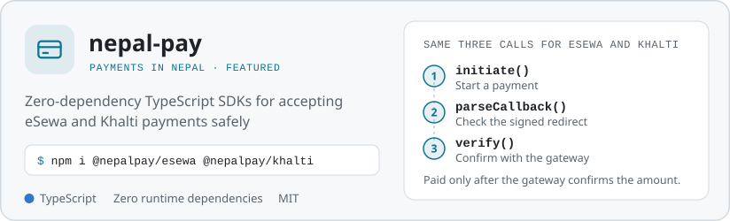
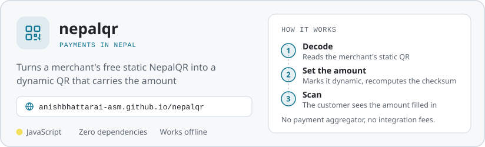
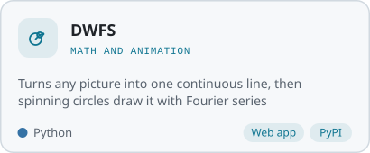
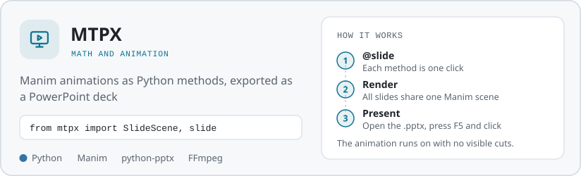
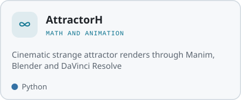
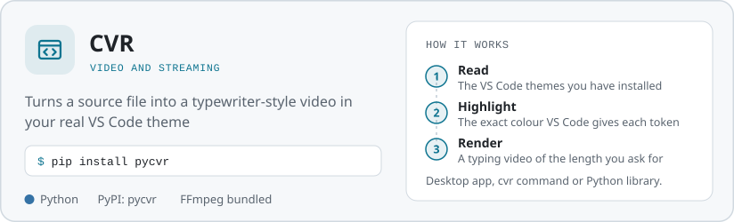
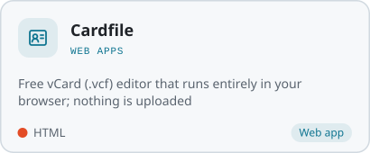
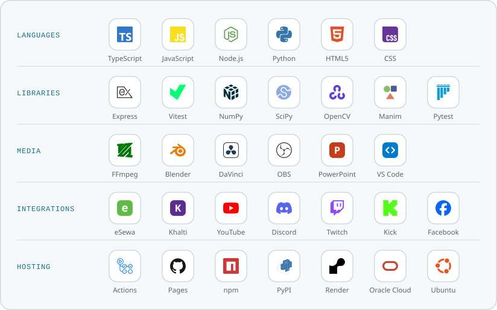

<a href="https://anishbhattarai-asm.github.io/"><picture><source media="(prefers-color-scheme: dark)" srcset="https://raw.githubusercontent.com/anishbhattarai-asm/anishbhattarai-asm/main/assets/banner-dark.svg"></picture></a>

  <a href="https://anishbhattarai-asm.github.io/"><picture><source media="(prefers-color-scheme: dark)" srcset="https://raw.githubusercontent.com/anishbhattarai-asm/anishbhattarai-asm/main/assets/link-portfolio-dark.svg"></picture></a>
  <a href="https://www.npmjs.com/org/nepalpay"><picture><source media="(prefers-color-scheme: dark)" srcset="https://raw.githubusercontent.com/anishbhattarai-asm/anishbhattarai-asm/main/assets/link-npm-dark.svg"></picture></a>
  <a href="https://pypi.org/project/dwfs/"><picture><source media="(prefers-color-scheme: dark)" srcset="https://raw.githubusercontent.com/anishbhattarai-asm/anishbhattarai-asm/main/assets/link-dwfs-dark.svg"></picture></a>
  <a href="https://pypi.org/project/pycvr/"><picture><source media="(prefers-color-scheme: dark)" srcset="https://raw.githubusercontent.com/anishbhattarai-asm/anishbhattarai-asm/main/assets/link-pycvr-dark.svg"></picture></a>

## Projects

  <a href="https://github.com/anishbhattarai-asm/nepal-pay"><picture><source media="(prefers-color-scheme: dark)" srcset="https://raw.githubusercontent.com/anishbhattarai-asm/anishbhattarai-asm/main/assets/card-nepal-pay-dark.svg"></picture></a>
  <a href="https://github.com/anishbhattarai-asm/nepalqr"><picture><source media="(prefers-color-scheme: dark)" srcset="https://raw.githubusercontent.com/anishbhattarai-asm/anishbhattarai-asm/main/assets/card-nepalqr-dark.svg"></picture></a>
  <a href="https://github.com/anishbhattarai-asm/DWFS"><picture><source media="(prefers-color-scheme: dark)" srcset="https://raw.githubusercontent.com/anishbhattarai-asm/anishbhattarai-asm/main/assets/card-dwfs-dark.svg"></picture></a>
  <a href="https://github.com/anishbhattarai-asm/MPX"><picture><source media="(prefers-color-scheme: dark)" srcset="https://raw.githubusercontent.com/anishbhattarai-asm/anishbhattarai-asm/main/assets/card-mpx-dark.svg"></picture></a>
  <a href="https://github.com/anishbhattarai-asm/MBDP"><picture><source media="(prefers-color-scheme: dark)" srcset="https://raw.githubusercontent.com/anishbhattarai-asm/anishbhattarai-asm/main/assets/card-mbdp-dark.svg"></picture></a>
  <a href="https://github.com/anishbhattarai-asm/CVR"><picture><source media="(prefers-color-scheme: dark)" srcset="https://raw.githubusercontent.com/anishbhattarai-asm/anishbhattarai-asm/main/assets/card-cvr-dark.svg"></picture></a>
  <a href="https://github.com/anishbhattarai-asm/247yt"><picture><source media="(prefers-color-scheme: dark)" srcset="https://raw.githubusercontent.com/anishbhattarai-asm/anishbhattarai-asm/main/assets/card-247yt-dark.svg"></picture></a>
  <a href="https://github.com/anishbhattarai-asm/Discord-Ytlive-automesseger"><picture><source media="(prefers-color-scheme: dark)" srcset="https://raw.githubusercontent.com/anishbhattarai-asm/anishbhattarai-asm/main/assets/card-discord-ytlive-automesseger-dark.svg"></picture></a>
  <a href="https://github.com/anishbhattarai-asm/VCF-Editor"><picture><source media="(prefers-color-scheme: dark)" srcset="https://raw.githubusercontent.com/anishbhattarai-asm/anishbhattarai-asm/main/assets/card-vcf-editor-dark.svg"></picture></a>

  <a href="https://anishbhattarai-asm.github.io/DWFS/"><picture><source media="(prefers-color-scheme: dark)" srcset="https://raw.githubusercontent.com/anishbhattarai-asm/anishbhattarai-asm/main/assets/try-dwfs-dark.svg"></picture></a>
  <a href="https://anishbhattarai-asm.github.io/nepalqr/"><picture><source media="(prefers-color-scheme: dark)" srcset="https://raw.githubusercontent.com/anishbhattarai-asm/anishbhattarai-asm/main/assets/try-nepalqr-dark.svg"></picture></a>
  <a href="https://anishbhattarai-asm.github.io/VCF-Editor/"><picture><source media="(prefers-color-scheme: dark)" srcset="https://raw.githubusercontent.com/anishbhattarai-asm/anishbhattarai-asm/main/assets/try-cardfile-dark.svg"></picture></a>

  <a href="https://www.npmjs.com/org/nepalpay"><picture><source media="(prefers-color-scheme: dark)" srcset="https://raw.githubusercontent.com/anishbhattarai-asm/anishbhattarai-asm/main/assets/link-npm-dark.svg"></picture></a>
  <a href="https://pypi.org/project/dwfs/"><picture><source media="(prefers-color-scheme: dark)" srcset="https://raw.githubusercontent.com/anishbhattarai-asm/anishbhattarai-asm/main/assets/link-dwfs-dark.svg"></picture></a>
  <a href="https://pypi.org/project/pycvr/"><picture><source media="(prefers-color-scheme: dark)" srcset="https://raw.githubusercontent.com/anishbhattarai-asm/anishbhattarai-asm/main/assets/link-pycvr-dark.svg"></picture></a>

## Tools

  <picture><source media="(prefers-color-scheme: dark)" srcset="https://raw.githubusercontent.com/anishbhattarai-asm/anishbhattarai-asm/main/assets/tools-dark.svg"></picture>

All projects as a list

| Project | What it does | Links |
|-|-|-|
| [nepal-pay](https://github.com/anishbhattarai-asm/nepal-pay) | Zero-dependency TypeScript SDKs for accepting eSewa and Khalti payments safely | [npm](https://www.npmjs.com/package/@nepalpay/esewa) &middot; [details](https://anishbhattarai-asm.github.io/projects/nepal-pay/) |
| [nepalqr](https://github.com/anishbhattarai-asm/nepalqr) | Turns a merchant's free static NepalQR into a dynamic QR that carries the amount | [web app](https://anishbhattarai-asm.github.io/nepalqr/) &middot; [details](https://anishbhattarai-asm.github.io/projects/nepalqr/) |
| [DWFS](https://github.com/anishbhattarai-asm/DWFS) | Turns any picture into one continuous line, then spinning circles draw it | [try it](https://anishbhattarai-asm.github.io/DWFS/) &middot; [PyPI](https://pypi.org/project/dwfs/) &middot; [details](https://anishbhattarai-asm.github.io/projects/dwfs/) |
| [MTPX](https://github.com/anishbhattarai-asm/MPX) | Manim animations as Python methods, exported as a PowerPoint deck | [details](https://anishbhattarai-asm.github.io/projects/mpx/) |
| [AttractorH](https://github.com/anishbhattarai-asm/MBDP) | Cinematic strange attractor renders through Manim, Blender and DaVinci Resolve | [details](https://anishbhattarai-asm.github.io/projects/mbdp/) |
| [CVR](https://github.com/anishbhattarai-asm/CVR) | Turns a source file into a typewriter-style video in your real VS Code theme | [PyPI](https://pypi.org/project/pycvr/) &middot; [details](https://anishbhattarai-asm.github.io/projects/cvr/) |
| [Stream Panel](https://github.com/anishbhattarai-asm/247yt) | Runs a 24/7 YouTube live stream from your videos or a lofi playlist on a free server | [details](https://anishbhattarai-asm.github.io/projects/247yt/) |
| [Discord YouTube Live Auto Messenger](https://github.com/anishbhattarai-asm/Discord-Ytlive-automesseger) | Posts in your Discord server the moment you go live on YouTube, once per stream | [details](https://anishbhattarai-asm.github.io/projects/discord-ytlive-automesseger/) |
| [Cardfile](https://github.com/anishbhattarai-asm/VCF-Editor) | Free vCard (.vcf) editor that runs entirely in your browser; nothing is uploaded | [open it](https://anishbhattarai-asm.github.io/VCF-Editor/) &middot; [details](https://anishbhattarai-asm.github.io/projects/vcf-editor/) |

